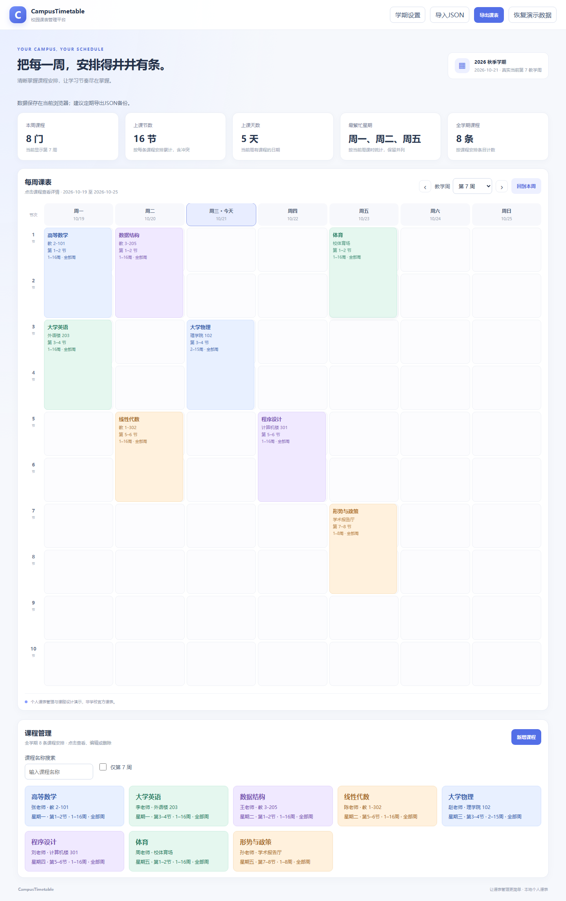

# Campus Timetable 校园课表管理系统

React 19 + TypeScript 6 + Vite 8 大学软件工程课程设计 MVP。保留原项目蓝紫色卡片、渐变背景与周课表风格，支持课程管理、真实教学周、持久化和JSON交换。无服务端，示例数据不是学校官方课表。

## 环境与启动

验证环境：Windows、Node.js 22.23.2、npm 10.8.2。要求Node.js 22.12+，建议现代Chromium浏览器。

```sh
npm ci
npm run dev
```

访问终端显示的本地地址（默认 http://localhost:5173）。数据按浏览器和地址隔离，演示时保持主机名与端口一致。

```sh
npm run typecheck
npm run lint
npm test
npm run build
npm run preview
```

浏览器测试：先执行 `npx playwright install chromium`，再执行 `npm run test:e2e`。测试自动在127.0.0.1:4173启动/关闭临时服务，需端口空闲；独立上下文不会读取个人浏览器课表。截图在docs/screenshots。代码格式：`npm run format`、`npm run format:check`。

## 功能

- 完整新增、编辑、删除、详情、全学期列表、名称搜索和显示周筛选。
- 教师、地点、星期、节次范围、周次范围、单/双/全部周、四种课程颜色。
- 上一周、下一周、指定周、真实本周、今日高亮、空状态。
- 可配置学期名称、开学日期、教学周数、每日节次。
- 冲突课程和具体周次警告、勾选后保存、冲突卡片并排显示。
- 修改自动保存、刷新恢复、演示数据初始化和确认恢复、非法本地数据保护。
- 带schemaVersion的JSON导出、校验、预览确认、原仓库旧版转换。
- 数据驱动的显示周课程数/课时/天数/繁忙星期、全学期条目数。
- 响应式布局、局部横向滚动、可访问标签、原生对话框键盘操作。

运行时只依赖React/ReactDOM；Vitest、Playwright、Prettier仅是开发工具。

## 使用说明

1. 首次打开加载8条演示课程，顶部“学期设置”配置实际校历。
2. 课程管理中新增课程，填写所有字段。冲突时必须勾选确认，任何字段修改会清除旧确认。
3. 点击课表或列表进入详情，然后编辑或删除；删除有确认。
4. 教学周下拉框筛选课表；列表可勾选“仅第N周”，名称搜索只影响列表。
5. 导出下载当前完整数据；导入先预览，确认后整体替换学期及全部课程，不合并。
6. 恢复演示数据会同时替换课程和学期，先导出需要保留的数据。
7. 存储失败时修改暂留内存并提示，仍可导出；刷新可能丢失未保存修改。

### 计算与校验口径

开学日期所在的周一至周日算第1教学周，包括该周开学日期之前的日期。单双周按教学周编号计算，跨年不重置。当前日期取浏览器本地日期，每30秒刷新。示例开学日期2026-09-07，因此2026-10-21恰为第7周，代码不再硬编码第7周。

学期外显示“尚未开始”或“已结束”，“回到本周”显示最近边界周。周数1–53，每日节次1–24，课程最多500条，名称/教师/地点各1–100字符。拒绝空白、反向区间、超范围、重复ID和没有实际开课周的单双周组合。

全学期按课程安排条目计数，同名不同时间算不同条；课时按节数累加，冲突课程也分别累计；最繁忙星期按课时计算，保留并列。节次只显示编号，不猜测学校钟点时刻。

### JSON格式与旧版兼容

参考 [版本1样例](examples/timetable-v1.json) 和 [旧版样例](examples/timetable-legacy.json)。

```json
{
  "schemaVersion": 1,
  "semester": {
    "name": "2026 秋季学期",
    "startDate": "2026-09-07",
    "totalWeeks": 20,
    "periodsPerDay": 10
  },
  "courses": [
    {
      "id": "example-1",
      "name": "软件工程",
      "teacher": "张老师",
      "room": "教学楼101",
      "day": 1,
      "start": 1,
      "end": 2,
      "startWeek": 1,
      "endWeek": 16,
      "parity": "all",
      "color": "blue"
    }
  ]
}
```

parity为all/odd/even；color为blue/green/purple/orange。导入文件最多2MB，未知版本拒绝。

原格式是 `{school, week, courses}`，课程含数字ID、`weeks: "1-16周"`。转换ID为字符串、周次为范围、规则为全部周。旧版不含学期配置，**沿用当前学期设置**，并在预览明确提示；week只是历史显示状态，不作为真实教学周。原格式不包含任意周次列表，因此“1,3,5周”等文本拒绝猜测转换。

损坏存储触发临时演示数据并暂停自动覆盖。此时导出的是当前页面数据，不是损坏原文；需要原文时先从浏览器开发者工具备份campus-timetable:v1。确认恢复或导入替换可解除保护。

## 文档

- [原工程审计](docs/BASELINE.md)
- [架构与数据流](docs/ARCHITECTURE.md)
- [双人分工与真实贡献](docs/CONTRIBUTIONS.md)
- [测试报告与风险](docs/TEST_REPORT.md)
- [3–5分钟演示](docs/DEMO.md)



当前为单人单浏览器存储，不含登录、云同步、多学期并存、节假日调课、学校接口或多标签并发合并。真实手机、Firefox/Safari与学生人工答辩尚未验收。AI实现不能冒充某位学生已亲自完成的贡献。
