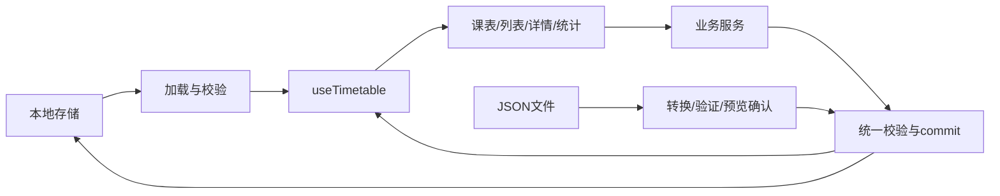

# 项目架构

## 模块边界

| 路径                            | 职责                                        |
| ------------------------------- | ------------------------------------------- |
| src/models/index.ts             | 统一Course、Semester、TimetableData及枚举   |
| src/data/demo.ts                | 独立创建演示数据                            |
| src/utils/date.ts               | 日历自然日、周一锚点、跨年、导航边界        |
| src/utils/timetable.ts          | 单双周、具体冲突周、并排布局                |
| src/utils/validation.ts         | 运行时数据校验与规范化                      |
| src/features/courses/service.ts | 不可变CRUD、冲突确认、学期一致性            |
| src/features/semester/          | 学期表单及错误反馈                          |
| src/features/statistics/        | 纯统计函数与统计展示                        |
| src/services/storage.ts         | localStorage适配、恢复和写入异常            |
| src/services/importExport.ts    | 新旧版本转换、验证和下载                    |
| src/hooks/                      | 统一数据状态/提交、真实日期更新             |
| src/components/                 | 周课表、课程表单/详情/列表、Modal、导入预览 |
| src/App.tsx                     | 页面组合和操作编排                          |
| tests/unit、tests/e2e           | 业务单测和真实Chromium交互                  |

类型不依赖业务；算法依赖模型；校验依赖日期和开课判断；服务依赖校验；UI通过hook/服务提交。无循环依赖，无额外全局状态库。

## 数据流

CRUD返回新对象，不修改原对象；学期设置验证全部现有课程，有越界即整体拒绝，不截断数据。导入必须预览确认后提交。统计与筛选是派生数据，不单独存储。

## 周次与冲突

本地当前日期取浏览器年/月/日。UTC时间戳仅作自然日算术，不替换用户时区，避免夏令时23/25小时影响。

第1周周一 = 开学日期自然日 − (星期编号+6) mod 7。
教学周 = floor((当前自然日−第1周周一)/7)+1。跨年不重置；非周一的开学日期仍以其所在完整周为第1周。真实周可以在学期范围外，仅导航截断并显示学期外提示。日期每30秒刷新，不强制打断用户当前所选周。

冲突检测依次排除同ID、不同星期、不相交节次；枚举共同周范围，同时满足双方单双周才返回冲突，结果包含课程和具体周次。节次是闭区间。用户必须勾选确认，修改表单会撤销旧确认。

同星期的相连区间分组，通过复用空闲列让冲突课程并排显示。每列至少130px，不将冲突卡片相互遮挡；小屏局部横向滚动，单卡过长可滚动并打开详情。

## 数据合同与统计

schemaVersion=1。ID为唯一非空字符串，新增用UUID。周数1–53、每日节次1–24、最多500条、文本1–100字符。校验整数、日期、起止顺序、范围、颜色/单双周枚举及实际开课周。规范化时只选取合法字段，不将任意导入属性带入状态。

导入按字节限制2MB，解析函数也限制字符串长度；未知版本拒绝。旧版数字ID转文本、weeks范围转数字、parity设all；学期沿用当前设置，旧week不用于推导校历。

条目数不是去重课程名称数。当前显示周的课时按每条课程节数累计（含冲突），繁忙星期按课时判定并保留并列。

## 持久化

唯一key：campus-timetable:v1，整体JSON一次写入。组件不访问localStorage。首次不存在数据时加载演示数据；每次修改/导入/恢复/设置保存即写入。有效空数组保留为空，不自动重置。

加载失败时回退临时演示数据并暂停覆盖，保存警告清晰可见。显式恢复或导入确认可解除保护。导出是当前页面对象，不是损坏原文；原文备份需通过浏览器存储工具。

写入失败保留内存修改并显示错误，可导出，不报告已保存。仅支持单人单标签使用，没有多标签合并。StoragePort可注入，单测使用内存实现。未来API可替换适配器、将hook提交改为异步；鉴权和远端并发仍需另行设计，本次不实现空服务端。

## UI与质量

保留原CSS视觉，原生表单和dialog提供基础键盘/焦点行为，明确标签、alert和status反馈。不引入重型UI库。TypeScript strict开启，测试文件也类型检查。Vitest、Playwright、Prettier均为开发依赖。没有删除测试或关闭类型检查。
